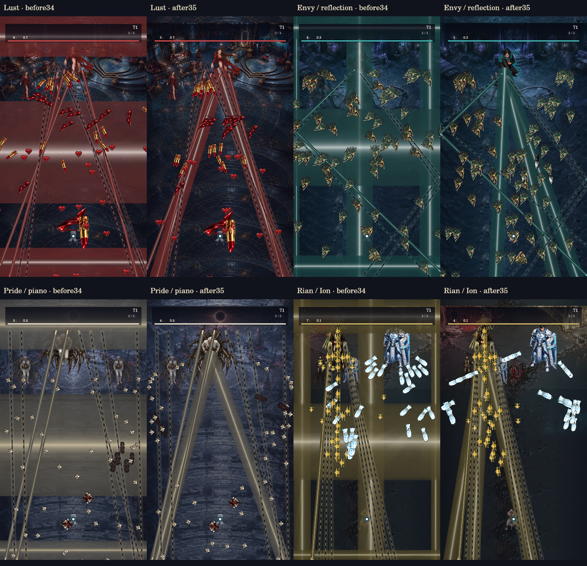

# 합일 v35 · 보스 광선과 하강 탄막

대상은 `kjb7876-lang/hapil-reboot`의 세로 모드입니다. 기준 main은 `509d1beb3a2bb6f4e75d880383fde28901ad5cdd`, 작업 브랜치는 `claude/v35-downfield-boss-lasers`입니다.

굵은 광선을 화면 가장자리의 띠에서 실제 보스 발사점의 하강 부채꼴로 변경했습니다. 공동 보스는 실제 참여자의 위치를 사용합니다. 광선은 y640까지 닿고, 보스는 경고·발사·잔광 중 위치를 유지한 다음 24틱에 걸쳐 원래 이동으로 복귀합니다. 잡몹 구간의 굵은 압박 광선은 제거했습니다. 경고90틱(여유102), 발사360틱, 잔광15틱은 보존합니다. 기존 면적 점유율66/44/22%를 새 부채꼴에 적용했다고 주장하지 않습니다. 실제 회피 통로는 별도로 검사합니다.

일반 탄환은 모양과 순서를 유지한 하단 경로로 퍼지며 y560까지 화면 안으로 내려옵니다. 회전·물결·분열·건반·1회 거울 반사를 유지하고, 가장자리 발사점을 하나씩 잘라 겹치던 문제를 전체 배열 맞춤으로 보정했습니다. 경고 전 경로를 확정해 경고 후 발사각이 바뀌지 않습니다. 안전한 조준 스트림은 원래 조준각을 유지합니다. 벽에서 반사 후 하강하는 보스 무기 물리는 그대로 사용합니다.

색욕·질투·교만·한리안/백이온의 실제 HELL31, 3페이즈, seed813, tick300입니다. 전후 각자의 코어를 실행했으며 무적·자동공격/스킬 해제 QA 장면입니다. 자연 플레이 클리어 증거는 아닙니다. [화면/해시/측정](scene-review.json), [브라우저 화면](lust-browser.jpg), [브라우저 검사](browser-review.json).

## 검증

- `npm test`: **537/537 통과**, 실패·건너뛰기0. [전체 로그](tests.log)
- 35보스×3페이즈×3난이도, 각1200틱: 일반탄의 y360 전 옆 이탈 **23,287→0**, 위 이탈 **7,783→0**. 최초 상향11,332→0. 최종 일반탄61,619개 관측.
- 실제 굵은 보스 광선1,188개, 몸체 연결 및 회피 경로554,940표본 각각 통과. 최대 탄환504/전체 광선17/굵은 광선3으로 기존 상한 내.
- 잡몹 구간105구성×600틱: 굵은 광선170,829프레임 표본→0. 일반탄2,622개 관측, 조기 이탈0.
- 변경 전후 합계882,000 실제 코어 틱. 독립 검사 [보고서](downfield-audit.json), 재현 `node tools/audit-downfield-v35.cjs`.
- 별도 영구 모듈 검사: 가장자리/중앙 발사점, 본체/분신 조합19,120탄환을 y540까지 추적해 캡슐 벽 침범·상향 이동·조기 이탈0.
- 원본 기록18경로, 일반 입력3,699,860틱, 저장 경계2,286개, 후속 입력411,480쌍 재생 통과. 원본 기록450파일 무변경. 과거 규칙30 이하의 원시 시뮬레이션도 기존 비교 검사 통과.

## 성능 범위

새 광선3줄을 저화질 모드에서 기존 정적 레이어로 묶습니다. 동일한 현재 장면을 비교한 후보 측정에서 3줄 캐시는 중앙값과 p95가 개선되어 채택했습니다. 2줄은 결과가 혼재해 직접 그리기를 유지합니다. [동일 장면 후보 측정](cache-experiment.json). 8개 품질별 비교에서 모든 피해 몸체 유지, 픽셀 채널 오차 최대4 이내, 레이어921,600바이트(DPR1), 예열 후 캔버스 추가 할당0입니다.

아래는 서로 다른 전후 전투 상태를 60회씩 그린 네이티브 CPU `renderer.draw` 호출 시간이며, 픽셀 읽기는 제외했습니다. 탄환/광선 수가 달라 동등 부하 벤치마크 또는 전체 성능 향상으로 해석하지 않습니다.

|장면|이전 중앙값|적용 후 중앙값|
|---|---:|---:|
|Lust|2.125 ms|2.091 ms|
|Envy / reflection|1.904 ms|1.966 ms|
|Pride / piano|1.490 ms|1.637 ms|
|Rian / Ion|2.860 ms|2.865 ms|

실기기 모바일 FPS, GPU 시간, GC 빈도, 장시간 실제 조작 클리어는 미검증입니다. 모바일30FPS 또는 데스크톱60FPS 달성을 주장하지 않습니다.

## 변경과 보존

- `src/core.js`: 보스 광선의 출처·끝점·자세, 하단 경로의 경고 전 확정, 잡몹 광선 제외.
- `src/boss-patterns-v27.js`: 배열 형태 맞춤, 하단 경로, 곡선 방향 제한, 1회 반사와 분열 경로.
- `src/render.js`: 측정에 근거한 굵은 광선3줄 캐시. 고화질/2줄/과거 규칙의 기존 동작 보존.
- `src/app.js`, `index.html`: 표시 버전과 캐시 키35 갱신. 전투 규칙/저장 형식은31 유지.
- 새 독립 QA3파일과 검수 도구/화면을 추가하고, 기존 현재31 캐시 검사는 실제 새 광선 개수에 맞춰 검증했습니다. 과거30 검사는 그대로입니다.

[보존 검사](preservation.json): 원본 미디어299개, 원본 기록450개와 미디어 등록·서사 자산·저장·무기·조준 흐름·난사 모듈 등 총755파일이 기준과 바이트 단위 동일합니다. 체력·피해·쿨타임·서사·맵·음원·원본 PNG는 수정하지 않았습니다. 이번 변경은 요청한 현재31 궤적과 굵은 광선의 전투 배치를 의도적으로 변경합니다.

이번에는 기존 소스 아트를 재사용해 외부 자산/스킬 추가 설치0, 유료 API 호출0입니다. `m0`, `hapil1`은 수정하지 않았습니다. 배포 커밋과 PR은 저장소 변경 이력에서 확인할 수 있습니다.
