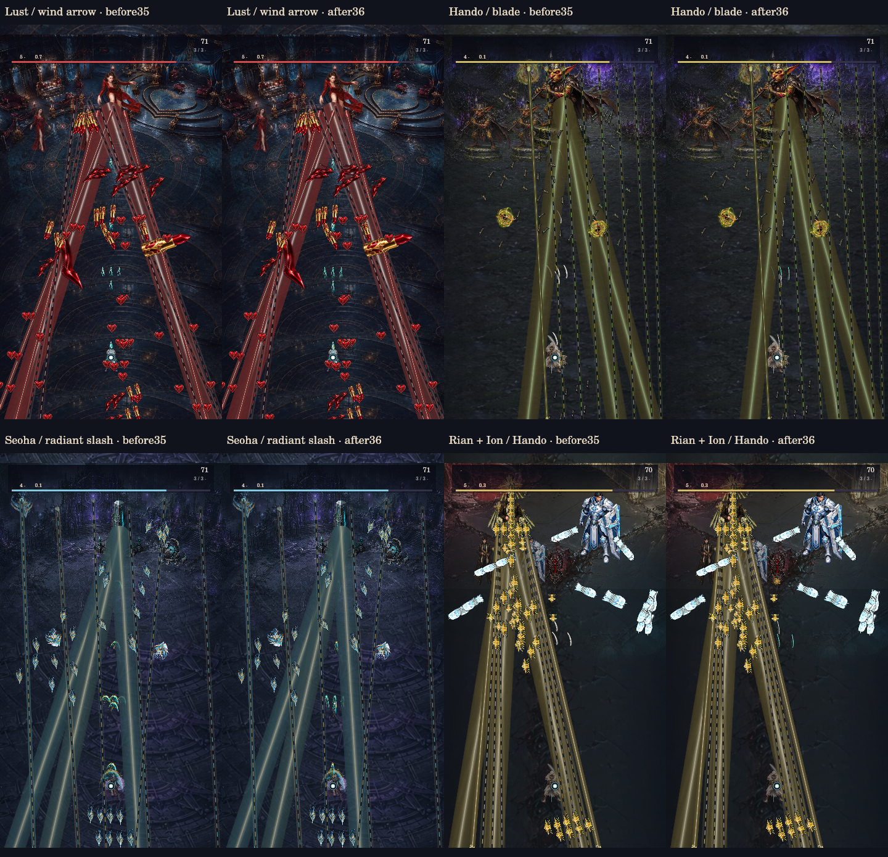
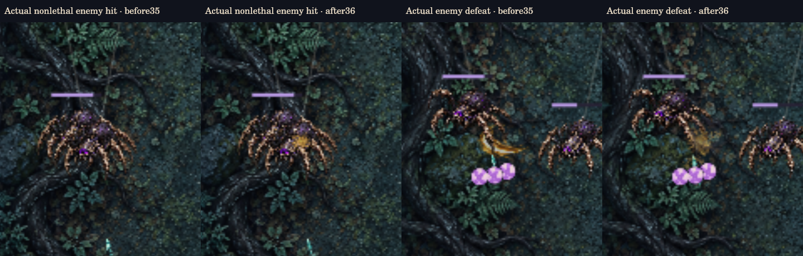

# 합일 v36 · 사격과 명중 반응

세로 리부트 `kjb7876-lang/hapil-reboot` 기준 `f616a344cfdc03af2bbc7cf98a17e2126123a4c0`에서 `claude/v36-shot-impact-polish`로 분기했습니다. `m0`·`hapil1`은 수정하지 않았습니다.

## 전수 조사 범위

- 자산299파일: 이미지296개 전부 실제 디코딩·알파 스캔, 오디오3개 ffprobe 검사. 등록288키와 이미지 크기·크롭·셀 계약478개에 누락/규격 오류0. 원본 자산 변경0. [자산 전수 기록](asset-audit.json) / [설명](asset-audit.md).
- 코드201파일(런타임15/테스트·도우미115/도구71) 전부 구문 분석. 15개 런타임 로더, 14개 격리 VM 모듈 등록, 앱의 리터럴 DOM 참조38개 확인. 오류0. 런타임 모듈별 역할과 주요 동작을 검토하고, 데이터로 된35개 일반탄·35개 레이저·35개 흐름 프로필과17개 서사 자산 구성을 순회했습니다. [코드 감사](runtime-audit.json) / [설명](runtime-audit.md).
- 모든 분기를 실행하거나 무결성을 형식적으로 증명했다는 뜻은 아닙니다. 미등록 보조 FX11개, 모바일 선택 계획에서 제외된42키, 기존 중복3그룹은 실제 미사용으로 단정하거나 삭제하지 않았습니다.
- 이 저장소는 기존 Canvas2D 렌더러를 사용합니다. 별도 프로젝트의 Three.js 구조로 교체하지 않았습니다.

## 실제 적용

일반 적의 비치명 명중에 접촉 효과가 없고, 자탄의 기본/기억/반격 구분이 약한 점을 개선했습니다.

- **자탄:** 기존 바람탄·환도·서하 소스의 밝은 끝을 실제 탄환점에 정렬하고 길쭉한 실체와 짧은 꼬리를 미리 합성했습니다. 기본·기억·반격·각성의 색·폭·길이를 구분합니다. 도형탄으로 대체하지 않습니다.
- **명중:** 실제 성공한 충돌의 최초 접촉점에서 짧은 중심 섬광→작은 파편이 이어집니다. 총구 반응5틱, 명중 반응15틱이며 정지/생략된 렌더가 수명을 늘리지 않습니다.
- **처치:** 기존 처치 이펙트의 수명에 맞춰 압축된 충격과 잔해·먼지가 퍼집니다. 보호된 연결 대상에 기존에 없던 죽음 폭발을 만들지 않습니다.
- **전투 판독:** 아군 효과는 적 몸체 위, 적탄·레이저 아래에 그리며 플레이어 피격점은 마지막에 유지합니다. 적의 피해 몸체를 숨기지 않습니다.
- **30FPS 대응:** 매60Hz 성공한 사격·충돌을 월드 밖의 opt-in WeakMap64슬롯에 기록합니다. 화면 사이에 태어나 사라진 사격도 실제 명중을 남깁니다. 소멸만 보고 피격을 추정하지 않습니다. 새 게임의 첫 업데이트 전에 등록합니다.

4개 실제 보스의 동일 상태를 저/고화질8경우에서 비교했습니다. 일반 적의 실제 비치명 명중과 실제 처치, 광선이 끝난 회복 구간의 명중도 따로 확인했습니다. 플레이어 무적 QA이며 적 HP·실제 자동 사격/스킬은 작동합니다. 자연 플레이 클리어 증거는 아닙니다. [장면·해시·측정](scene-review.json), [회복 구간 명중](contact-recovery.png), [실제 브라우저 화면](seoha-browser.jpg), [브라우저 수치](browser-review.json).

## 유명 게임 참고

[Psikyo 공식 STRIKERS1945 안내](https://psikyo-portal.com/pressrelease_200422.html)와 [공식 실제 화면](https://psikyo-portal.com/shootinglibrary.html), [ZUN의 동방영야초 공식 매뉴얼 화면](https://www16.big.or.jp/~zun/html/th08man/html/view.html)을 확인했습니다. 정지 화면에서 보이는 길고 좁은 자탄·적탄의 색/형태 대비와 명확한 탄막 간격을 디자인에 참고했습니다. 섬광 지속시간이나 충돌 처리 방식은 이 자료로 입증되지 않으며 이번 게임의 독자 설계입니다. 타 게임 이미지·음원은 도입하지 않았습니다. [출처·관찰과 추론 구분](reference-notes.md).

## 검증과 보존

`npm test` **554/554 통과**, 실패·건너뛰기0입니다. 최종 자동 검사 결과는 [전체 로그](tests.log)와 [검증 요약](validation.json)에 있습니다. 테스트를 삭제·비활성화하지 않았습니다.

새 모듈의5개 검사: 원본3탄환 가족×4등급의 밝은 끝·방향·차별화,96발 전체 표시, 실제 접촉점·효과 수명·예산·누락 자산·해제를 검사했습니다. 예열 후 화면 기하도형/픽셀 읽기를 금지해도 통과합니다.

실제 이벤트7개 검사: 독립 수치 해석으로 움직이는 표적과의 최초 접촉을 확인하고 접선/내부 출발/처치/선택 순서/만료/화면 이탈/새 월드 분리를 검사했습니다. 모든8규칙 선택자×35보스×3페이즈×3난이도 **2,520조합**에서 실제 입력·일반 체력으로180틱 실행한 월드/안전 저장값이 기준과 원시 JSON까지 동일했습니다.

통합4개 검사: 실제 사격·충돌이 새 레이어에 연결되며100회 예열 draw에서 새 캔버스/픽셀 읽기0, 과거30 화면 동일, 모든 적탄·레이저보다 새 효과가 먼저 그려지는 순서를 검사했습니다. 앱 검사는 렌더 관찰자 없이 첫 사격 기록이 생성됨을 확인합니다.

과거 입력18경로3,699,860틱, 저장 경계2,286개, 후속 입력411,480쌍 재검증을 통과했습니다. 원본 미디어299개·기록450개·변경하지 않은 런타임11개 등760파일이 기준과 바이트 단위 동일합니다. [보존 기록](preservation.json). 체력·피해·쿨타임·사격 수·적탄 패턴·서사·맵·세이브 형식은 보존했습니다. 전투 규칙31, 표시 버전36입니다.

## 렌더 비용과 한계

전용 소스 캐시는3가족/4등급/효과 전체688,128바이트이며 상한1MiB입니다. 실제 검수 장면 최대589,824바이트, 예열 후 캔버스 생성0·누락 자산0입니다. 저화질 명중8개·고화질12개의 작은 장식 예산만 제한하며 자탄96발은 모두 표시합니다. 렌더 종료 시 새 캐시도 해제합니다.

동일한 실제 전투 상태를60회씩 그린 네이티브 CPU `renderer.draw` 호출 시간입니다. 픽셀 읽기·검사·JSON 출력은 시간 측정 밖입니다. 공유 호스트의 CPU 부하는 통제되지 않았고 새 효과 비용은 소폭 증가했습니다. 성능 향상이나 기기 FPS로 해석하지 않습니다.

|장면(저화질)|이전 중앙값|적용 후 중앙값|
|---|---:|---:|
|Lust / wind arrow|2.926 ms|3.154 ms|
|Hando / blade|2.838 ms|3.361 ms|
|Seoha / radiant slash|1.428 ms|1.490 ms|
|Rian + Ion / Hando|2.075 ms|2.125 ms|

실기기 모바일 FPS·GPU 시간·GC 빈도·장시간 실제 조작은 미검증입니다. 실측하지 않은30/60FPS 달성을 주장하지 않습니다.

## 파일과 재현

- `src/combat-presentation-v36.js`: 새 독립 소스 스탬프·접촉·총구·처치 레이어.
- `src/core.js`: 저장과 분리된 실제 사격/접촉 기록. 선택한 충돌 판정 자체는 동일합니다.
- `src/render.js`, `src/app.js`, `index.html`: 레이어·최초 업데이트 관찰·로더·캐시 키 연결.
- 기존 QA VM/앱 도우미도 새 모듈을 로드하며, 과거 Git 참조에는 없는 모듈을 억지로 넣지 않습니다.
- `node tools/audit-assets-v36.cjs`, `node tools/audit-runtime-v36.cjs`, `node tools/review-shot-impact-v36.cjs`, `npm test`로 재현합니다. `tools/combat-review-v36.html`은 실제 코어를 쓰는 별도 브라우저 QA 화면입니다.

이번 변경은 기존 자산 재사용이며 새 외부 게임 자산·스킬 설치·유료 API 호출0입니다. 원본 이미지는 덮어쓰지 않았습니다. 배포 커밋·PR·Pages 상태는 저장소 변경 이력에 기록합니다.
