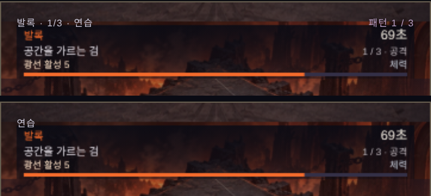

# 합일 v37 · 전투 음향과 HUD 중복 정리

`main`(v36, `d0cc397`)에서 `claude/v37-combat-audio`로 분기했습니다. 전투 규칙31·저장 형식·원본 자산은 바꾸지 않았습니다.

## 왜 음향인가

v36까지 그림 쪽은 탄환·레이저·명중 반응까지 다듬어졌지만 소리는 사격음·피격음 2개와 배경음 1곡뿐이었습니다. 스침, 광선 예고, 패턴 격파, 보스 등장처럼 탄막 게임에서 귀로 먼저 알아채는 신호가 전부 무음이었습니다. 상용 탄막 슈팅과 가장 차이가 큰 부분이라 이번 판은 여기에 집중했습니다.

## 적용 내용

- **전투 음향 22종** (`src/audio-v37.js`): 탄 스침, 보스 명중(체력 20% 이하에서 음색이 바뀜), 적 처치, 피격 보강, 보스 기 모으기, 광선 예고→발사, 자동 스킬 4종, 패턴 격파, 지원군, 봉인/해방, 사몽 각성, 보스 등장 경고, 승리/패배, 체력 1칸 심장박동, 패턴 종료 10초 전 초읽기.
- **음원 파일 0개**: 전부 Web Audio로 그 자리에서 합성합니다. 내려받는 용량이 늘지 않고 외부 음원 라이선스가 없습니다. 기존 `shot.wav`·`hurt.wav`·`music.mp3`는 그대로 씁니다.
- **전투 불변**: 음향 모듈은 world를 읽기만 합니다. 기존 설정의 "효과음" 스위치를 그대로 따르고, Web Audio가 없거나 막힌 브라우저에서는 조용히 빠집니다.
- **좌우 위치**: 보스·광선·플레이어의 가로 위치에 따라 소리가 좌우로 움직입니다(이어폰에서 체감).
- **HUD 중복 제거**: 보스전 상단에 보스 이름이 두 번, "1/3"이 세 번 겹쳐 나오던 것을 캔버스 HUD 한 벌로 정리하고 `연습`/`HELL` 표시만 남겼습니다. 본편의 "전투 구간 n / m"은 유지합니다.
- **파비콘**: 매 접속마다 나던 `favicon.ico` 404를 없앴습니다.

## 검증

- 새 검사 8개(`tests/audio-v37.test.cjs`): 보스 4종 2,400틱 동안 음향 관찰을 붙인 판과 붙이지 않은 판의 world 전체가 JSON까지 동일, 실제 보스전에서 신호 10계열 발생, 이어하기 직후 과거 상태 재생 없음, 신호별 1회 발화, 심장박동·초읽기 규칙, 22종 전부 합성 경로 실행, 최소 간격·효과음 스위치, Web Audio 실패 시 무해, 모듈이 world에 대입하지 않고 음원을 내려받지 않음.
- 전체 `npm test` 결과와 v36 대비 비교는 [validation.json](validation.json).
- 헤드리스 Chrome에서 22종을 오프라인 렌더링해 측정했습니다([sound-levels.json](sound-levels.json)). 단일 신호 최대 피크 0.38, 가장 시끄러운 8종을 동시에 울려도 0.59로 클리핑이 없습니다.

## 한계 — 반드시 귀로 확인해 주세요

- **작성자는 소리를 들을 수 없습니다.** 음량·길이·주파수는 수치로만 맞췄습니다. 음색이 세계관에 어울리는지, 반복해서 들어도 거슬리지 않는지는 사람 귀로만 판단할 수 있습니다. `tools/sound-review-v37.html`에서 22종을 하나씩 들을 수 있습니다.
- 실기기(아이폰 스피커) 청취, 무음 스위치 동작, 장시간 플레이 시 피로도는 미검증입니다. iOS는 무음 스위치가 켜져 있으면 합성음이 나지 않습니다.
- 배경음은 여전히 1곡입니다. 보스별 곡은 이번 범위가 아닙니다.
- 모바일 FPS·발열에 대한 영향은 측정하지 않았습니다. 초당 발음 수와 동시 발음 수(28)에 상한을 두었지만 실기기 확인이 필요합니다.

## 참고

음향이 탄막 슈팅의 타격감과 정보 전달에 핵심이라는 점은 [Boghog's bullet hell shmup 101](https://shmups.wiki/library/Boghog's_bullet_hell_shmup_101)과 shmups 포럼의 개발 피드백을 참고했습니다. 타 게임의 음원·이미지는 쓰지 않았고, 소리 설계는 이 게임의 독자 합성입니다.
