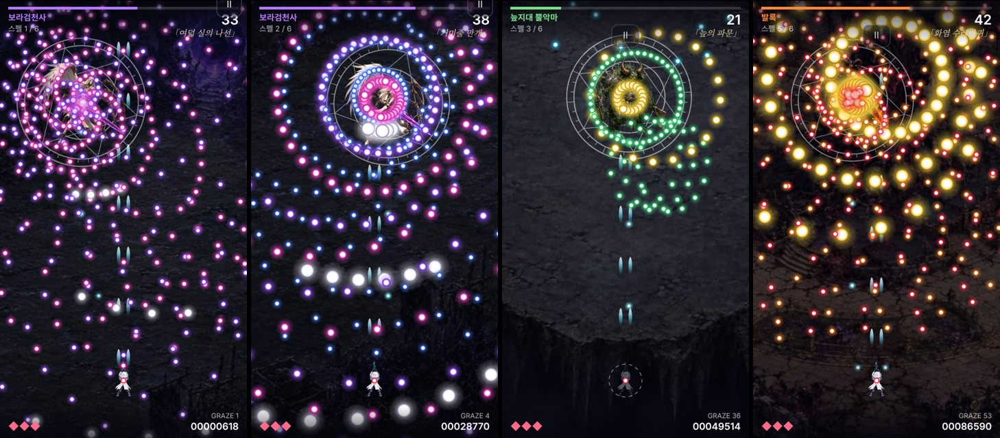

# 합일 v38 · ARCADE 탄막 모드 (시제품)

동방 계열처럼 빛나는 구슬탄이 화면을 채우는 오락실풍 한 판 모드입니다. `arcade.html`에서 따로 열리며 첫 화면의 "ARCADE 탄막 모드" 버튼으로 들어갑니다.

## 왜 별도 모드인가

스토리 전투(규칙31)는 탄 하나하나가 예고·회피 통로·저장·재현 검사에 묶여 있어, 그 안에서 탄 수를 몇 배로 늘리면 35개 보스와 기존 검사 554개가 한꺼번에 흔들립니다. 그래서 구슬탄 전용 엔진을 따로 만들어 **화면과 손맛, 휴대폰 성능을 먼저 확인**할 수 있게 했습니다. 방향이 맞으면 이 패턴들을 스토리 보스로 옮기는 것이 다음 단계입니다. 스토리 모드의 전투·저장·자산은 바꾸지 않았습니다.

## 들어 있는 것

- **구슬탄 엔진** (`src/arcade-v38.js`): 탄 최대 1,400발, 60Hz 고정, 시드 난수로 결정적. 회전·가감속·멈췄다 다시 조준·각도 꺾기를 지원합니다.
- **보스 3 × 스펠 6**: 보라검천사(여덟 실의 나선, 거미줄 만개) → 늪지대 뿔악마(늪의 파문, 썩은 비의 장막) → 발록(화염 수레바퀴, 최후의 만다라). 기본 난이도 화면 최대 약 480~650발, 지옥 약 560~750발.
- **탄막 게임 관례**: 피격 판정은 흰 점(반지름 2.4)만, 탄은 보이는 크기의 절반만 닿음, 갓 나온 탄은 0.2초간 무해하게 피어남, 맞으면 화면의 탄이 지워지고 2.5초 무적, 스침 점수, 스펠 격파 시 남은 탄이 점수로 바뀜, 스펠 이름 컷인, 제한 시간.
- **공격**: 곧은 주포 + 보스를 따라가는 유도탄. 구석에서 버텨도 시간 안에 깰 수 있고, 보스 밑에 서면 훨씬 빨리 깹니다.
- **조작**: 화면 아무 곳이나 끌면 그만큼 움직입니다. PC는 방향키/WASD, Shift 저속.
- **자동 화질 조절**: 프레임이 느리면 해상도 → 빛무리 순으로 내리고 탄 수는 유지합니다.
- **자산**: 기존 플레이어·보스 3종·배경 3종만 사용. 구슬탄·마법진·효과는 코드로 그립니다. 소리는 v37 합성 음향을 재사용합니다. 받아 오는 용량은 약 1MB로 스토리 모드(약 17MB)보다 훨씬 가볍습니다.

## 검증

- 새 검사 7개(`tests/arcade-v38.test.cjs`): 같은 시드 재현, 세 난이도 끝까지 진행·탄 누락 0·밀도 순서, 보스 밑/구석 양쪽 클리어 가능, 피격 시 탄 소거와 무적, 피어나는 탄 무해·스침 1회, 이동 범위, 스토리 엔진과 분리.
- 전체 `npm test` 결과: [validation.json](validation.json).
- 헤드리스 Chrome(소프트웨어 렌더링), 지옥 난이도 약 550발: CPU 1배 16.7ms, 4배 감속 약 18ms(해상도 자동 하향), 6배 감속 약 20ms(빛무리 생략). **실제 휴대폰 수치가 아닙니다.**

## 한계

- **사람이 실제로 해 보지 않았습니다.** 자동 회피 봇과 무적 상태 화면으로만 확인했습니다. 난이도가 적당한지, 끌기 감도가 맞는지는 직접 해 봐야 압니다. 봇은 기본 난이도를 거의 안 맞고 깼지만 사람에게는 더 어렵습니다.
- 실기기(아이폰) FPS·발열은 미측정입니다.
- 아직 없는 것: 폭탄, 아이템·콤보, 잡몹 구간, 보스별 음악, 이어하기, 광고 연동.
- 배포: 지금은 웹 페이지입니다. 스토어 출시·광고에는 앱 포장과 광고 SDK 작업이 따로 필요합니다.
