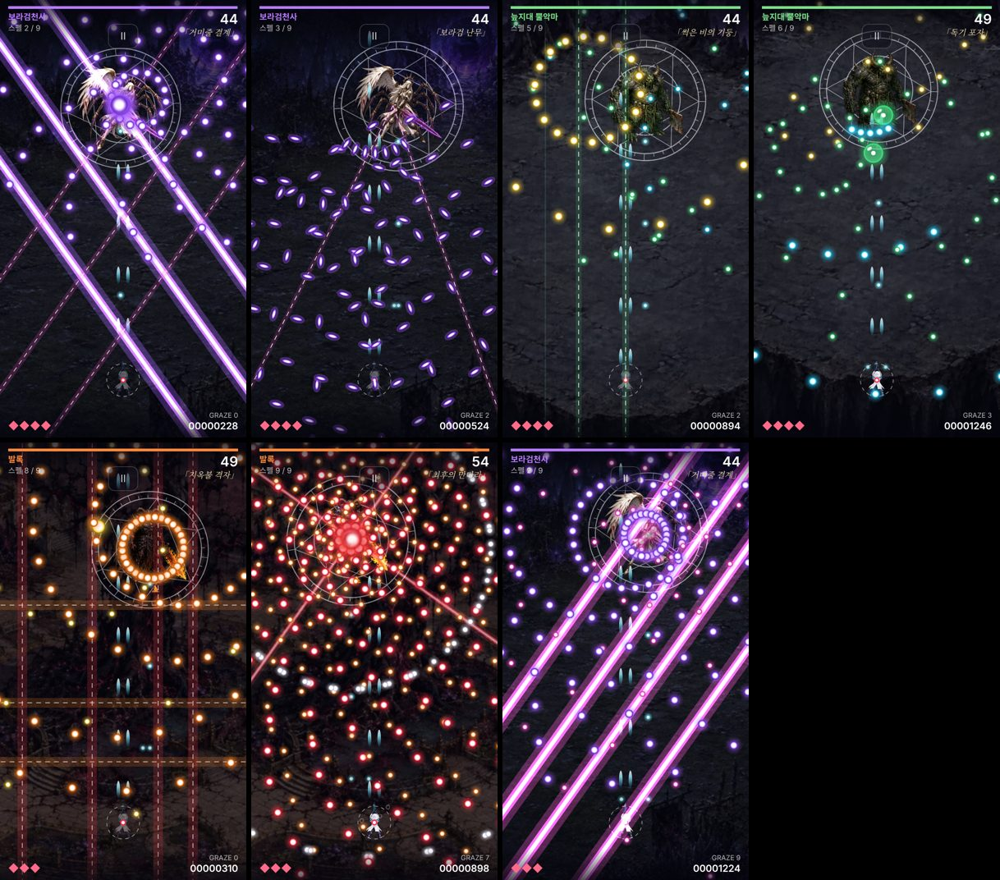

# 합일 v39 · ARCADE 보스별 광선과 난이도 구분

v38 ARCADE 모드(`arcade.html`)에 보스별 고유 공격과 광선을 넣고 난이도 세 단계를 뚜렷하게 갈랐습니다. 스토리 모드는 건드리지 않았습니다.

## 보스별 특색 — 스펠 9개

| 보스 | 색 | 스펠 | 특징 |
|---|---|---|---|
| 보라검천사 | 보라·자홍 | 여덟 실의 나선 | 맞도는 이중 나선 + 흰 쌀알탄 |
| | | 거미줄 결계 | **대각선 광선**이 좌우에서 번갈아 그물을 침 |
| | | 보라검 난무 | 영웅을 겨눈 **참격 광선**, 켜지는 순간 선을 따라 쌀알탄이 흩어짐 |
| 늪지대 뿔악마 | 초록·노랑 | 늪의 파문 | 멈췄다가 영웅을 다시 겨누는 고리 |
| | | 썩은 비의 기둥 | **세로 광선 기둥**. 첫 기둥은 영웅 머리 위 |
| | | 독기 포자 | 큰 거품이 떠오다 터져 고리로 갈라짐 |
| 발록 | 빨강·주황 | 화염 수레바퀴 | 휘어지는 불꽃 나선 |
| | | 지옥불 격자 | **가로줄 → 세로줄 광선**이 번갈아, 지옥은 동시에 켜져 바둑판 |
| | | 최후의 만다라 | 보스를 축으로 **도는 광선 바퀴** + 겹나선 |

광선은 가는 점선 예고 → 발사 → 잔광 순서이며 예고 중에는 닿지 않습니다. 맞으면 탄과 광선이 함께 지워집니다.

## 난이도

| | 여유 | 기본 | 지옥 |
|---|---:|---:|---:|
| 목숨 | 6 | 4 | 3 |
| 보스 교체 시 회복 | 2 | 1 | 1 |
| 탄 속도 | 0.66배 | 0.82배 | 1.08배 |
| 탄 수 | 0.7배 | 1배 | 1.8배 |
| 영웅 피격점 반지름 | 1.4 | 2.0 | 2.4 |
| 탄이 닿는 범위(보이는 크기 대비) | 36% | 46% | 50% |
| 광선 예고 시간 | 1.6배 | 1.2배 | 1배 |
| 광선 굵기 | 0.72배 | 0.88배 | 1배 |
| 광선 수(그물/참격/기둥/격자/바퀴살) | 2/1/2/2+2/2 | 3/2/3/3+3/3 | 4/3/5/3+4 동시/4 |

기본은 v38보다 쉬워졌습니다(탄 수 1.25→1배, 속도 0.9→0.82배, 목숨 3→4, 피격점 축소). 지옥의 탄 수·속도는 v38 그대로에 광선과 전용 탄 층이 더해졌습니다.

## 검증

- `tests/arcade-v38.test.cjs` 11개(기존 7개 갱신 + 신규 4개): 광선 예고 무해·발사 즉시 피격·옆 틈 안전·원점 뒤로 닿지 않음, 회전은 발사 뒤에만, 참격의 쌀알탄, 거품 분열, 카드별 광선 방향(대각선만/세로만/가로+세로/회전)과 난이도 순서.
- 이번 변경 뒤에는 ARCADE·음향 검사 19개만 다시 돌렸습니다. 스토리 쪽 파일은 v38의 전체 569개 통과 이후 바뀌지 않았습니다.
- 예고선을 보고 피하는 자동 봇(시드 2개): 여유 피격 0~1회, 기본 1회, 지옥 13~14회. 한 판 약 4분 40초~5분.

## 한계

- 여전히 **사람이 해 본 결과가 아닙니다.** 봇 수치는 "피할 수 있게 만들어졌는지"와 난이도 간 간격만 보여 줍니다.
- 실기기 FPS·발열 미측정. 지옥 마지막 스펠은 약 460~560발 + 광선 4줄입니다.
- 스토리 모드 35개 보스에는 아직 반영하지 않았습니다.
