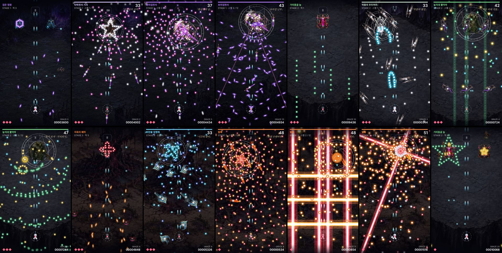

# 합일 v40 · ARCADE 총집본 — 일반 몹 · 중간 보스 · 보스

`arcade.html` 한 판이 맵 셋으로 이어집니다. 스토리 모드는 건드리지 않았습니다.

## 구성 (15구간, 봇 기준 약 7분)

| 맵 | 일반 몹 구간 | 중간 보스 | 보스 스펠 |
|---|---|---|---|
| 1 검은 정원 | 황금각 순서로 내려오는 거미 떼, 육각 거미줄을 쏘는 수문장 | 타락천사 기사 — 오망성의 서약(별 + 던지는 보라검) | 보라검천사 — 황금각의 실 / 거미줄 결계 / 보라검 난무 |
| 2 거미동굴 늪 | 줄지어 가로지르는 고블린, 종곡선·별을 쏘는 감시자 | 악몽의 우두머리 — 악몽의 쌍검(도는 쌍검 + 종곡선) | 늪지대 뿔악마 — 늪의 파문 / 썩은 비의 기둥 / 독기 포자 · 가지치기 |
| 3 지옥의 폐허 | 사인 곡선으로 내리꽂는 박쥐 떼, 장미·삼각형을 쏘는 망령 | 파란불 집행체 — 시간의 장미(장미 곡선 + 초승달 + 첨탑) | 발록 — 화염 수레바퀴 / 지옥불 격자 / 최후의 만다라 |

## 목숨

| | 여유 | 기본 | 지옥 |
|---|---:|---:|---:|
| 목숨 | 7 | 3 | 1 |
| 다음 맵에서 회복 | 전부 | 1 | 없음 |

탄 속도·탄 수·피격점·광선 규칙은 v39와 같습니다.

## 큰 기물 (기존 원화에서 잘라 만든 7종, 합계 약 74KB)

| 기물 | 쓰는 곳 | 원본 |
|---|---|---|
| 보라검 | 기사가 던짐, 보라검천사 주위로 돌며 퍼짐 | `media/weapon-v12/violet-sword.png` |
| 식칼 | (예비) | `media/weapon-v12/horn-cleaver.png` |
| 화염검 | 발록 수레바퀴에서 휘며 돎 | `media/weapon-v12/balrog-sword.png` |
| 비석 | 뿔악마의 광선 기둥이 꺼진 자리로 떨어짐 | `media/story-v19/deletion-obelisk.webp` |
| 신경 첨탑 | 집행체가 위에서 떨굼 | `media/story-v19/neural-obelisk.webp` |
| 쌍검 | 우두머리가 고리로 던짐 | `media/story-v19/chief-blade.webp` |
| 초승달 | 집행체가 휘어 던짐 | `media/story-v19/chrono-crescent.webp` |

드라이브를 찾아봤지만 저장소에 이미 맞는 원화가 있어 그것을 썼고, 닷츠에 새로 의뢰하지는 않았습니다. 기물은 가운데 흰 심만 닿고 가장자리는 스침입니다.

## 기하 탄막 — 수식 그대로

- **황금각 잎차례**: 한 발마다 137.5°(= π(3−√5))씩 돌려 쏨. 해바라기 씨앗처럼 나선 팔이 저절로 생김.
- **정다각형·별**: 변 위의 점들을 "원점에서의 거리에 비례한 속도"로 쏴서 모양을 유지한 채 커짐.
- **장미 곡선** r = 0.3 + 0.7·cos²(kθ/2), 꽃잎 4장·5장 교대.
- **코흐 눈송이**: 변의 가운데 1/3을 삼각형으로 바꾸기를 2번(꼭짓점 48개).
- **시에르핀스키 삼각형**: 가운데를 비우기를 2번(꼭짓점 15개).
- **황금 나선**: 90°마다 반지름이 황금비만큼 커지는 로그 나선.
- **비트루비우스**: 원과 그 안의 정사각형.
- **가우스 종곡선**: 부채꼴 속도가 exp(−u²/2σ²)를 따라 가운데가 가장 빠름.
- **프랙탈 가지치기**: 한 알이 셋으로, 다시 셋으로(1→3→9→27).

## 검토와 반영

스킬로 코드 리뷰와 디자인 비평을 직접 돌렸습니다(외부 사람 검수는 아닙니다). 반영한 것:

- 어두운 비석·검이 배경에 묻힘 → 기물 아래 색 빛무리 추가.
- 박쥐·거미 몹이 배경에 묻힘 → 몹 아래 맵 색 빛무리 추가.
- 일시정지 버튼이 보스와 탄 위에 겹침 → 왼쪽 위 글자 아래로 이동.
- 황금 나선이 점 수의 절반 이상을 버리고 있었음 → 전 구간을 쓰도록 수정.
- 영웅 가까이 내려온 몹이 코앞에서 쏨 → 영웅 구역(화면 아래쪽)에서는 발사 금지.

## 검증

- `tests/arcade-v38.test.cjs` 12개 + 음향 8개 = 20개 통과. 구간 순서, 난이도별 목숨·회복, 도형의 수학적 성질(육각형 변 위의 점, 별의 꼭짓점 수, 장미 꽃잎 수, 코흐·시에르핀스키 점 수, 황금비 성장), 도형이 커져도 모양 유지, 가지치기 1→3→9→27, 보스별 광선·기물, 몹 구간 진행을 봅니다.
- 스토리 쪽 파일은 v38의 전체 569개 통과 이후 바뀌지 않아 전체 검사는 다시 돌리지 않았습니다.
- 예고선을 보는 자동 봇(시드 1개): 여유 피격 0회, 기본 2회로 끝까지, 지옥은 첫 피격(약 1분 50초, 보라검 난무)에서 종료.

## 한계

- **사람이 해 본 결과가 아닙니다.** 봇은 "피할 수 있게 만들어졌는지"만 보여 줍니다. 지옥 목숨 1은 봇도 끝까지 못 갑니다.
- 실기기 FPS·발열 미측정. 헤드리스 PC에서 프레임 16.7~20ms.
- 일반 몹 구간은 탄이 적습니다(30~120발). 숨 고르는 구간으로 의도했지만 심심할 수 있습니다.
- 식칼은 아직 쓰는 패턴이 없습니다. 폭탄·아이템·보스별 음악·광고 연동도 없습니다.
